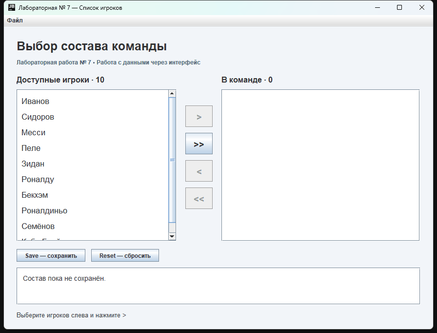

# Лабораторная работа № 7

## Управление

- `>` и `<` переносят выбранных игроков между списками. Несколько строк можно выбрать с Ctrl или Shift.
- `>>` и `<<` переносят всех игроков.
- **Save** показывает выбранный состав в диалоге и сохраняет его снимок внизу окна в пределах текущего сеанса.
- **Reset** восстанавливает исходный список и очищает команду.
- **Файл → Выход** закрывает приложение после подтверждения.

## Файлы

- `src/` — исходный код: модель, представление, контроллер и точка входа.
- `dist/PlayersList.jar` — готовое приложение.
- `demo.gif` — демонстрация работы приложения.
